# ManuTrack

Plataforma web de monitoramento de manutenção industrial: sensores, alertas, previsão de falhas e ordens de serviço em um só lugar.

  

**Autor:** Breno Soad · CST em Big Data para Indústria (BDI), 2º ciclo · Fatec São Carlos
**Disciplina:** IES-013 – Engenharia de Software

## Sumário

1. [Sobre o Projeto](#1-sobre-o-projeto)
2. [Tecnologias, Ferramentas e Infraestrutura](#2-tecnologias-ferramentas-e-infraestrutura)
3. [Metodologias utilizadas](#3-metodologias-utilizadas)
4. [Projeto de Interface](#4-projeto-de-interface)

---

## 1. Sobre o Projeto

### 1.1 Descrição

O **ManuTrack** coleta dados de sensores instalados em máquinas de uma fábrica (temperatura, vibração e pressão), mostra o estado de cada equipamento em tempo real e gera alertas quando uma medição ultrapassa o limite configurado.

Com o histórico acumulado, o sistema calcula o risco de falha de cada máquina e permite abrir e acompanhar ordens de serviço. O objetivo é reduzir paradas não planejadas e passar da manutenção apenas corretiva para a **preventiva e preditiva**.

### 1.2 Problema que resolve

Em muitas fábricas a máquina só é consertada depois que quebra. Cada parada custa produção, e a causa costuma ser descoberta tarde, sem histórico confiável. O ManuTrack registra o que os sensores medem, avisa antes do limite crítico e deixa rastreado quem fez qual manutenção e quando.

### 1.3 Usuários

| Perfil | O que precisa fazer |
|---|---|
| Técnico de manutenção | Receber alertas, abrir e fechar ordens de serviço, registrar o reparo |
| Supervisor de produção | Acompanhar o painel, priorizar ordens, ver relatórios de disponibilidade |
| Administrador | Cadastrar máquinas, sensores, limites de alerta e usuários |

### 1.4 Requisitos funcionais

| Código | Requisito | Prioridade |
|---|---|---|
| RF01 | Autenticar usuários com e-mail e senha, com controle por perfil | Alta |
| RF02 | Cadastrar máquinas, sensores e limites de alerta | Alta |
| RF03 | Receber leituras dos sensores continuamente e armazenar o histórico | Alta |
| RF04 | Exibir painel com o estado de todas as máquinas em tempo real | Alta |
| RF05 | Gerar alerta de nível atenção ou crítico ao ultrapassar um limite | Alta |
| RF06 | Notificar o técnico responsável por e-mail e no aplicativo | Média |
| RF07 | Abrir, atribuir, acompanhar e concluir ordens de serviço | Alta |
| RF08 | Calcular o risco de falha e a previsão de dias até a falha | Média |
| RF09 | Gerar relatórios de disponibilidade, MTTR e MTBF | Média |
| RF10 | Exportar leituras e ordens em CSV | Baixa |

### 1.5 Requisitos não funcionais

| Código | Requisito |
|---|---|
| RNF01 | O painel deve refletir uma nova leitura em até 5 segundos |
| RNF02 | O sistema deve suportar 500 sensores enviando 1 leitura por segundo |
| RNF03 | Senhas armazenadas com hash e toda comunicação via HTTPS |
| RNF04 | Disponibilidade mensal mínima de 99,5% |
| RNF05 | Interface responsiva para uso em computador e celular |
| RNF06 | Cobertura de testes automatizados de pelo menos 70% no back-end |

### 1.6 Histórias de usuário

| Como... | Quero... | Para... | Critério de aceite |
|---|---|---|---|
| Técnico | receber um alerta quando a temperatura passar do limite | agir antes da máquina parar | O alerta aparece no painel e chega por e-mail em até 10 s |
| Técnico | abrir uma ordem de serviço a partir do alerta | registrar o reparo sem digitar de novo | A ordem nasce com máquina, sensor e valor preenchidos |
| Supervisor | ver quantas máquinas estão em atenção ou críticas | decidir onde mandar a equipe | O painel mostra a contagem por estado |
| Supervisor | baixar o relatório mensal | prestar contas à diretoria | O PDF traz disponibilidade, MTTR e MTBF do período |
| Administrador | definir o limite de cada sensor | adequar os alertas a cada máquina | O novo limite vale a partir da próxima leitura |

### 1.7 Casos de uso

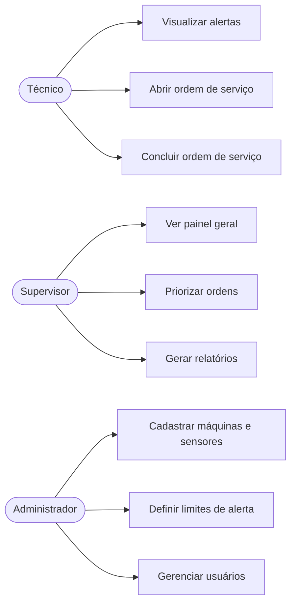

### 1.8 Ciclo de vida da ordem de serviço

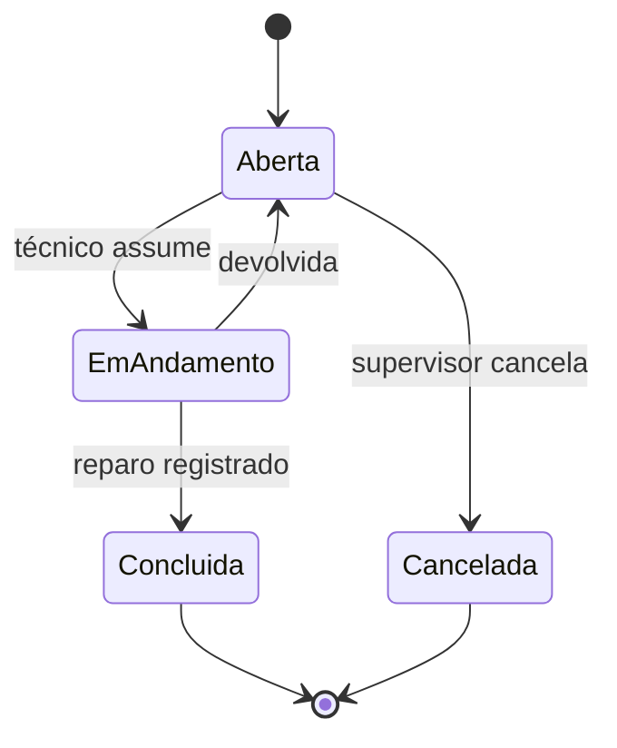

### 1.9 Fora do escopo (versão 1.0)

- Controle de estoque de peças
- Integração direta com ERP
- Comando remoto das máquinas (o sistema só lê e avisa)

---

## 2. Tecnologias, Ferramentas e Infraestrutura

| Camada | Tecnologia | Por que |
|---|---|---|
| Back-end | Python 3.12 com FastAPI | Rápido, tipado e com documentação automática da API |
| Front-end | React com TypeScript | Componentes reaproveitáveis e menos erros em tempo de compilação |
| Banco relacional | PostgreSQL | Integridade para usuários, máquinas e ordens de serviço |
| Séries temporais | TimescaleDB | Consultas rápidas sobre milhões de leituras por data e hora |
| Mensageria | MQTT com Mosquitto | Protocolo leve, padrão em sensores industriais |
| Análise e previsão | Pandas e scikit-learn | Preparação dos dados e modelo de risco de falha |
| Contêineres | Docker e Docker Compose | Mesmo ambiente em desenvolvimento e produção |
| Cloud | AWS (EC2, RDS e S3) | Servidores, banco gerenciado e armazenamento dos relatórios |
| Integração contínua | GitHub Actions | Testes e análise a cada pull request |
| Testes | Pytest e Vitest | Back-end e front-end |
| Qualidade | Ruff, ESLint e Prettier | Padronização do código |
| Protótipos | HTML e CSS | Telas exportadas como imagem |
| Gestão | GitHub Issues e GitHub Projects | Rastreabilidade do pedido ao código |

### 2.1 Arquitetura

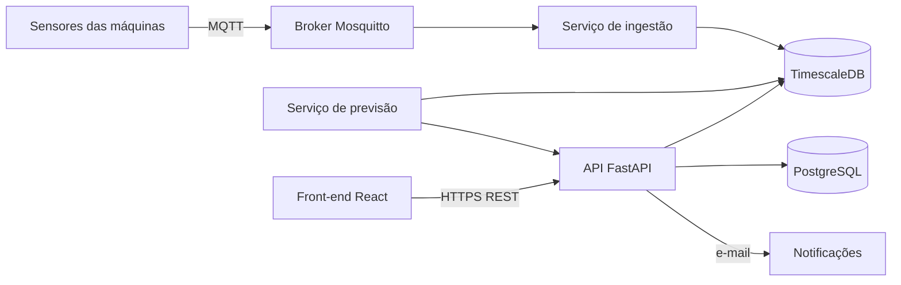

Fluxo: os sensores publicam leituras via MQTT, o serviço de ingestão grava no TimescaleDB e avalia os limites, a API entrega os dados ao front-end e o serviço de previsão recalcula o risco de falha a cada hora.

### 2.2 Modelo de dados

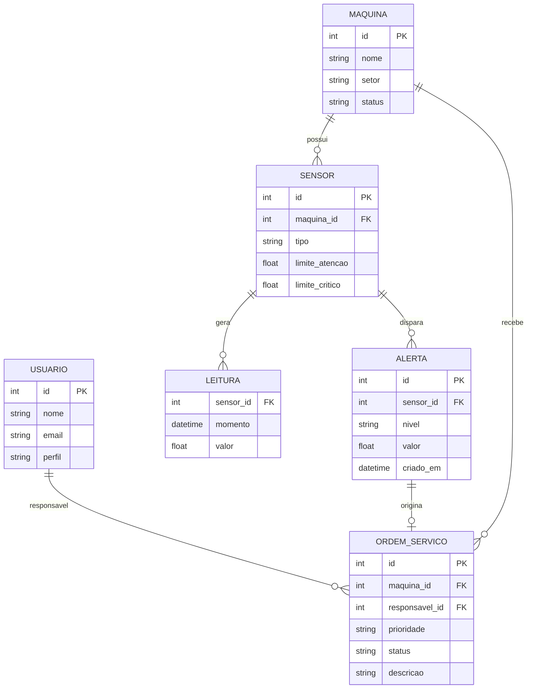

### 2.3 Estrutura de pastas

```text
manutrack/
├── backend/          # API FastAPI, ingestão e previsão
│   ├── src/
│   └── tests/
├── frontend/         # Aplicação React
│   ├── src/
│   └── tests/
├── docs/
│   ├── adr/          # Registros de decisão de arquitetura
│   └── telas/        # Protótipos de interface
├── docker-compose.yml
├── CHANGELOG.md
└── README.md
```

### 2.4 Como executar (desenvolvimento)

```bash
git clone https://github.com/<usuario>/manutrack.git
cd manutrack
docker compose up --build
```

O front-end sobe em `http://localhost:3000` e a documentação da API em `http://localhost:8000/docs`.

---

## 3. Metodologias utilizadas

### 3.1 Processo: iterativo e incremental (ágil), com riscos do Espiral

Escolhemos um processo **iterativo e incremental**, com sprints de duas semanas, e **não Cascata**.

| Critério | Cascata | Escolha para o ManuTrack |
|---|---|---|
| Requisitos | Fechados antes de programar | Mudam conforme o contato com a operação (sensores, limites, alertas) |
| Entrega de valor | Só no fim do projeto | Painel e leitura de sensores já na primeira sprint |
| Risco técnico (previsão de falha) | Descoberto tarde | Tratado aos poucos, com avaliação a cada sprint |
| Feedback de quem usa | Depois de pronto | A cada sprint, na revisão |

Do **Espiral** aproveitamos a análise de riscos no início de cada sprint:

| Risco | Probabilidade | Impacto | Resposta |
|---|---|---|---|
| Sensores enviando dados com falhas ou atraso | Alta | Alto | Validar a leitura na ingestão e registrar falhas |
| Modelo de previsão com pouca precisão | Média | Médio | Começar por regras simples de limite e evoluir para o modelo |
| Volume de leituras sobrecarregar o banco | Média | Alto | TimescaleDB, índices por tempo e teste de carga |
| Mudança de requisitos no meio do semestre | Alta | Médio | Sprints curtas e backlog reavaliado a cada ciclo |

### 3.2 Planejamento das sprints

| Sprint | Entrega | Versão |
|---|---|---|
| 1 | Estrutura do projeto, login, cadastro de máquinas e sensores | 0.1.0 |
| 2 | Ingestão MQTT, armazenamento das leituras e painel geral | 0.2.0 |
| 3 | Regras de alerta e notificações | 0.3.0 |
| 4 | Ordens de serviço | 0.4.0 |
| 5 | Relatórios e exportação em CSV | 0.5.0 |
| 6 | Previsão de falhas, ajustes e testes finais | 1.0.0 |

### 3.3 Uso do Git e do GitHub

O projeto segue a cadeia de rastreabilidade **issue → ramo → commit → pull request → merge → release**:

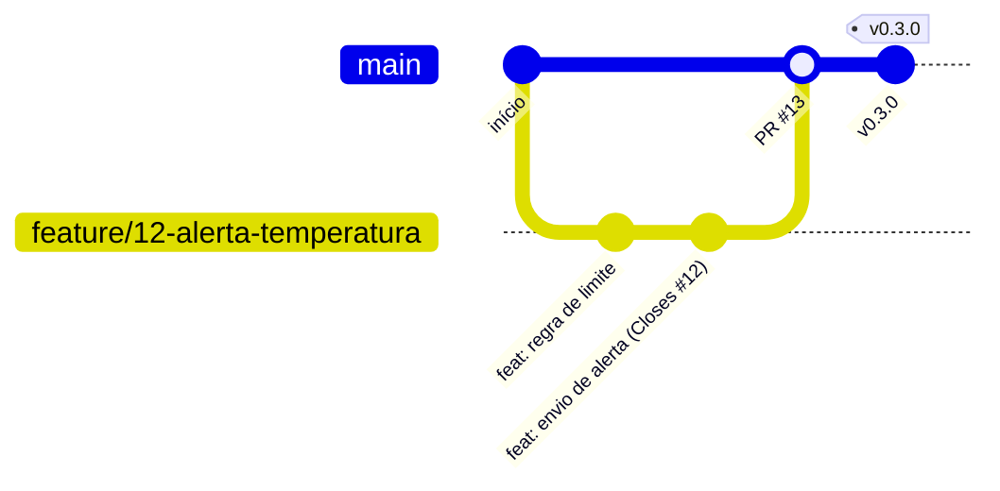

| Elo | Como é aplicado |
|---|---|
| Issue | Todo pedido vira uma issue, com título que expressa o resultado esperado (ex.: «exportar leituras em CSV») e critério de conclusão |
| Ramo | `main` é sempre estável. Cada trabalho nasce em um ramo com a referência à issue (ex.: `feature/12-alerta-temperatura`) |
| Commit | Prefixos `feat:`, `fix:`, `docs:` e `refactor:`, com `Closes #N` para vincular à issue |
| Pull request | Nenhuma alteração entra na `main` sem revisão de outra pessoa e testes passando |
| Merge | Integra na `main` e fecha a issue automaticamente |
| Release | Tag anotada (ex.: `v0.1.0`) com notas copiadas do CHANGELOG |

Outras práticas:

- **Quadro:** GitHub Projects com as colunas A fazer, Em andamento, Em revisão e Concluído.
- **Rótulos:** tipo (`bug`, `feature`, `docs`), prioridade e tamanho.
- **Versionamento semântico (MAIOR.MENOR.CORREÇÃO):**
  - **Maior:** quebra compatibilidade, como renomear um campo da API ou mudar o formato do CSV exportado.
  - **Menor:** funcionalidade nova sem quebrar o que existe.
  - **Correção:** apenas conserto de defeito.
  - Antes da `1.0.0` tudo pode mudar. Publicar a `1.0.0` é assumir compromisso de estabilidade.
- **CHANGELOG.md:** escrito para quem usa o sistema, por versão e por tipo (Adicionado, Corrigido, Alterado e Removido), com cada linha apontando a issue.
- **ADR:** decisões de arquitetura registradas em `docs/adr/` (ADR 001: escolha do TimescaleDB; ADR 002: política de versionamento).
- **Gestão de configuração e de mudança:** configuração responde «o que existe?» (versões, dependências, lockfile, imagens Docker). Mudança responde «por que existe?» (issue, pull request e revisão).
- **Reprodutibilidade:** a versão do conjunto de dados e do modelo de previsão é registrada em cada release.
- **Plano de retorno:** toda release pode ser revertida para a tag anterior, e mudança emergencial é registrada depois, nunca esquecida.

### 3.4 Qualidade

- Testes automatizados executados pelo GitHub Actions em todo pull request
- Revisão de código obrigatória por outra pessoa
- Definição de pronto: critério de aceite cumprido, testes passando, documentação atualizada

---

## 4. Projeto de Interface

Protótipos das telas principais. Fluxo de navegação:

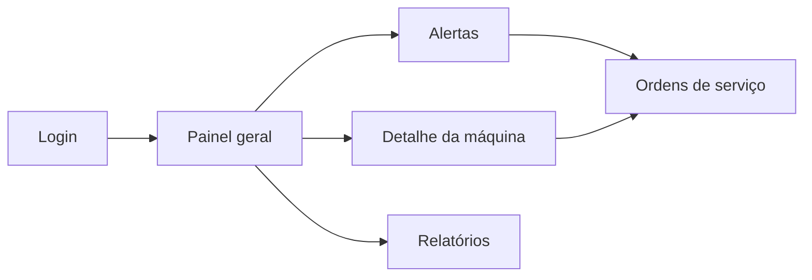

### 4.1 Login
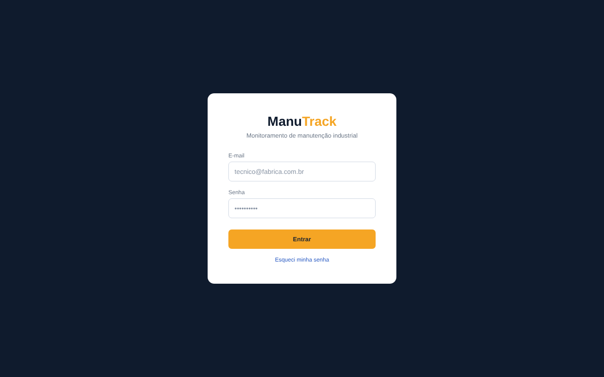

### 4.2 Painel geral
Resume o estado das máquinas e mostra o gráfico de vibração e os alertas mais recentes.
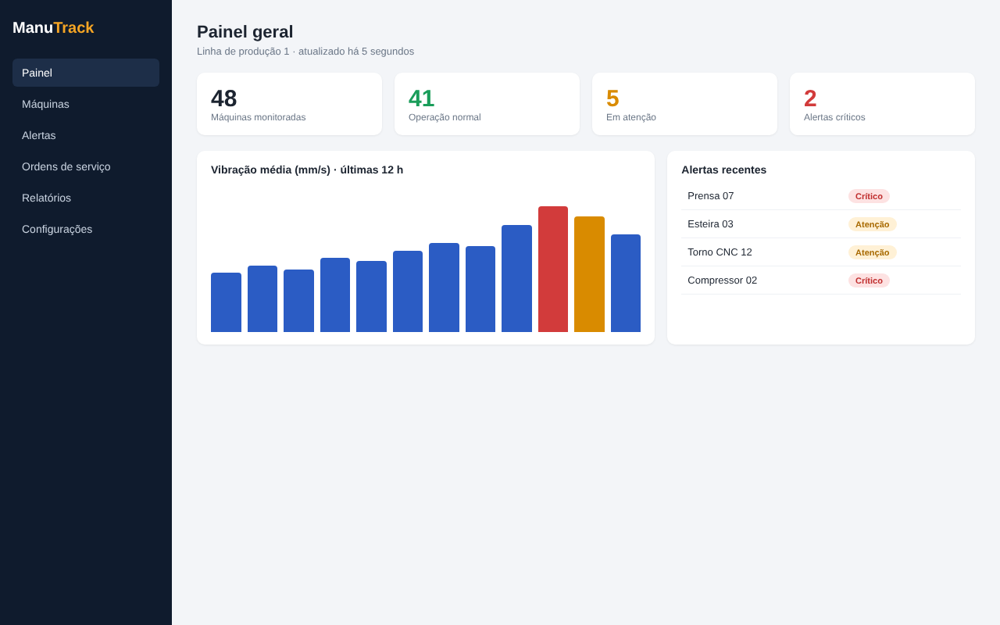

### 4.3 Detalhe da máquina
Mostra as medições atuais, o gráfico de temperatura, a previsão de falha e o botão para abrir uma ordem de serviço.
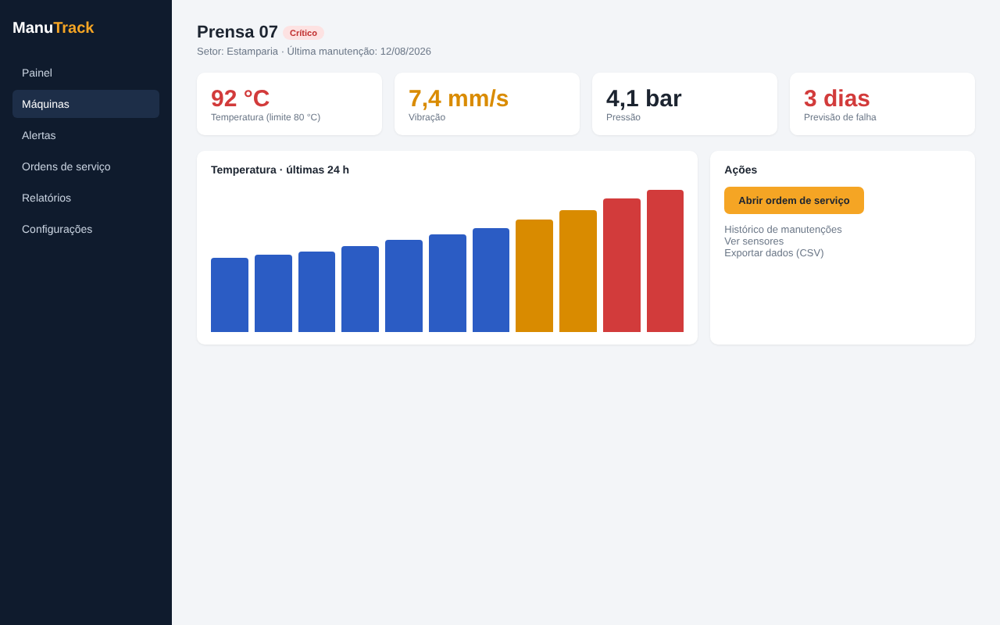

### 4.4 Alertas
Lista os alertas por nível, com valor medido, limite e a ação de reconhecer.
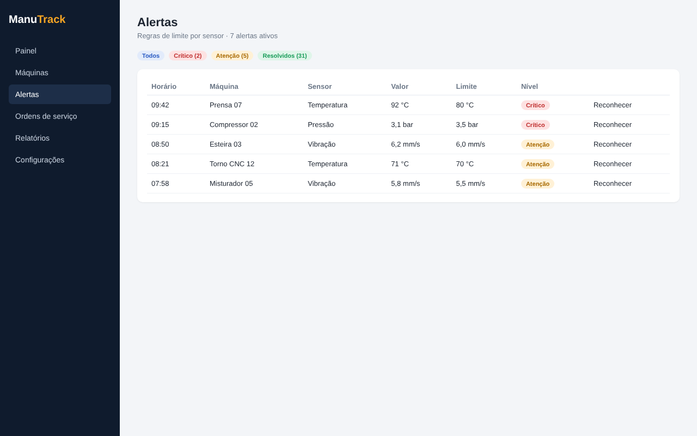

### 4.5 Ordens de serviço
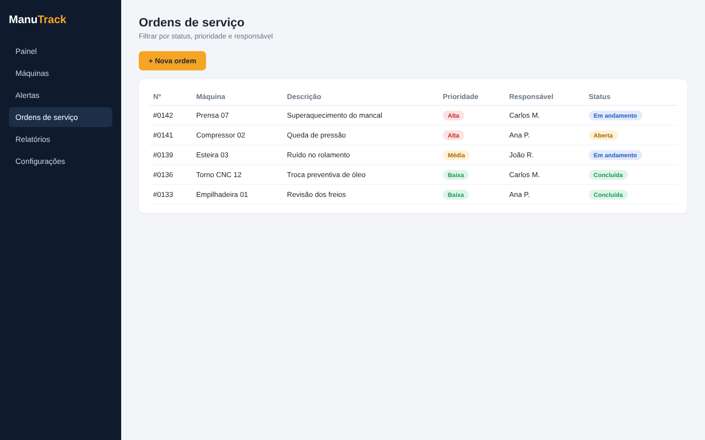

### 4.6 Relatórios
Indicadores de disponibilidade, MTTR e MTBF, com exportação em CSV e PDF.
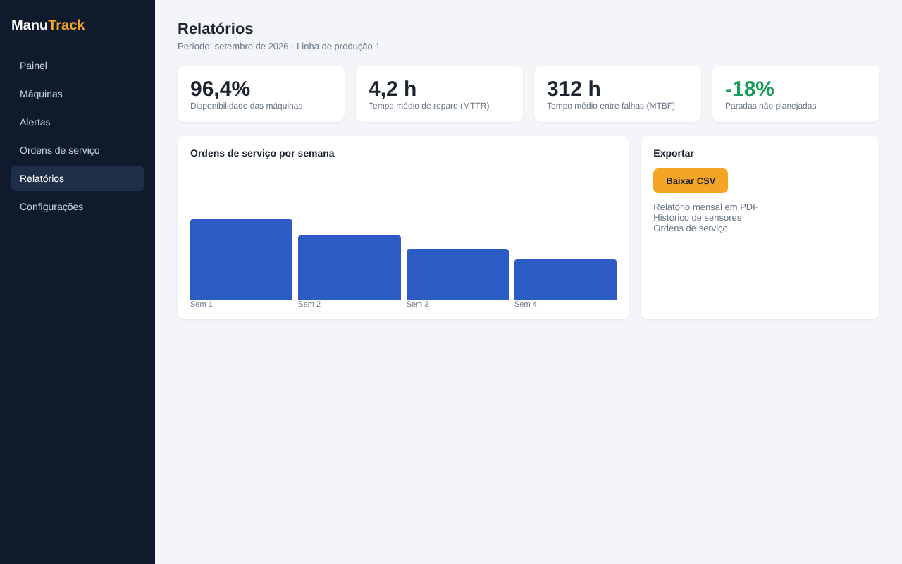

### 4.7 Versão para celular
O técnico recebe e acompanha os alertas direto no chão de fábrica.

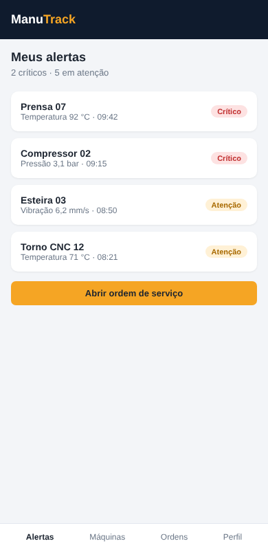

---

## Licença

Distribuído sob a licença MIT.
